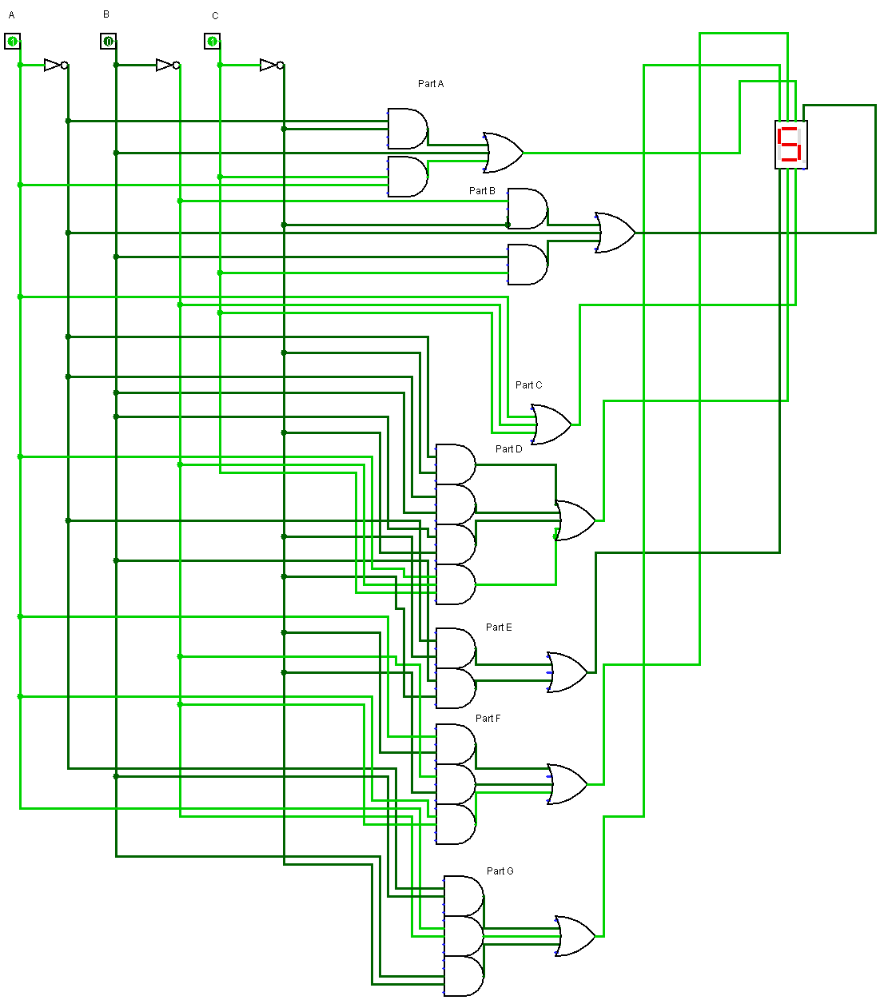
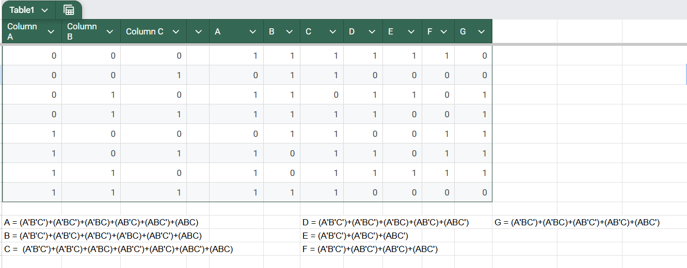
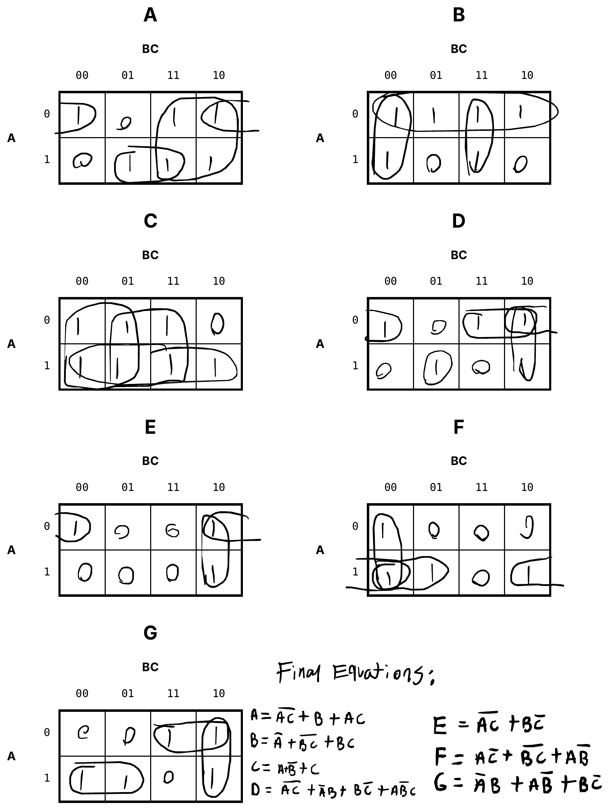
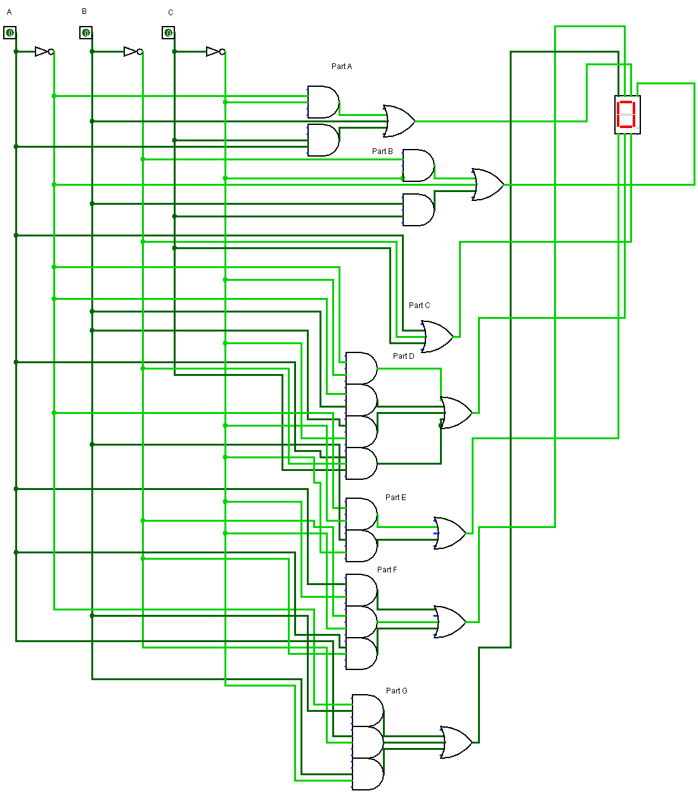
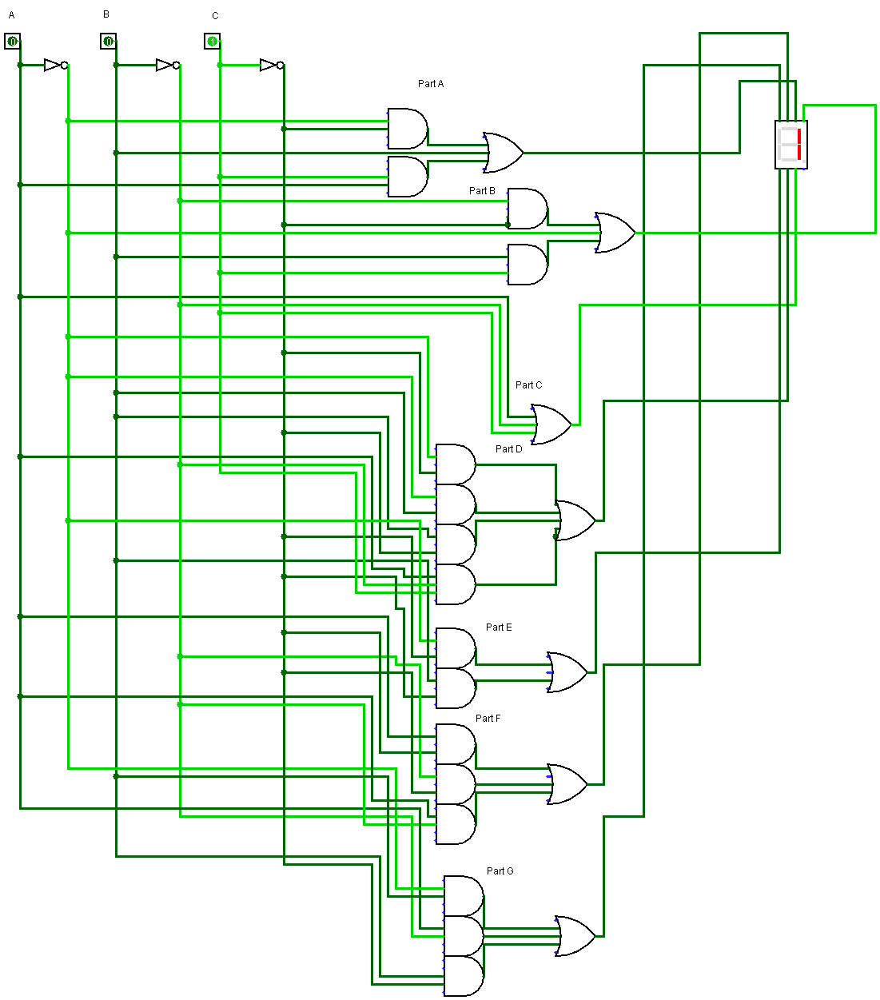
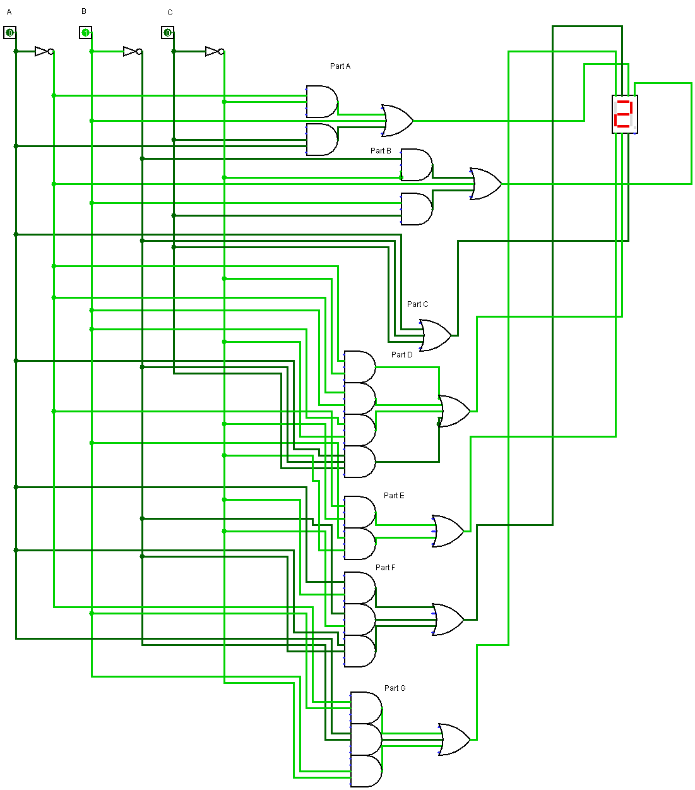
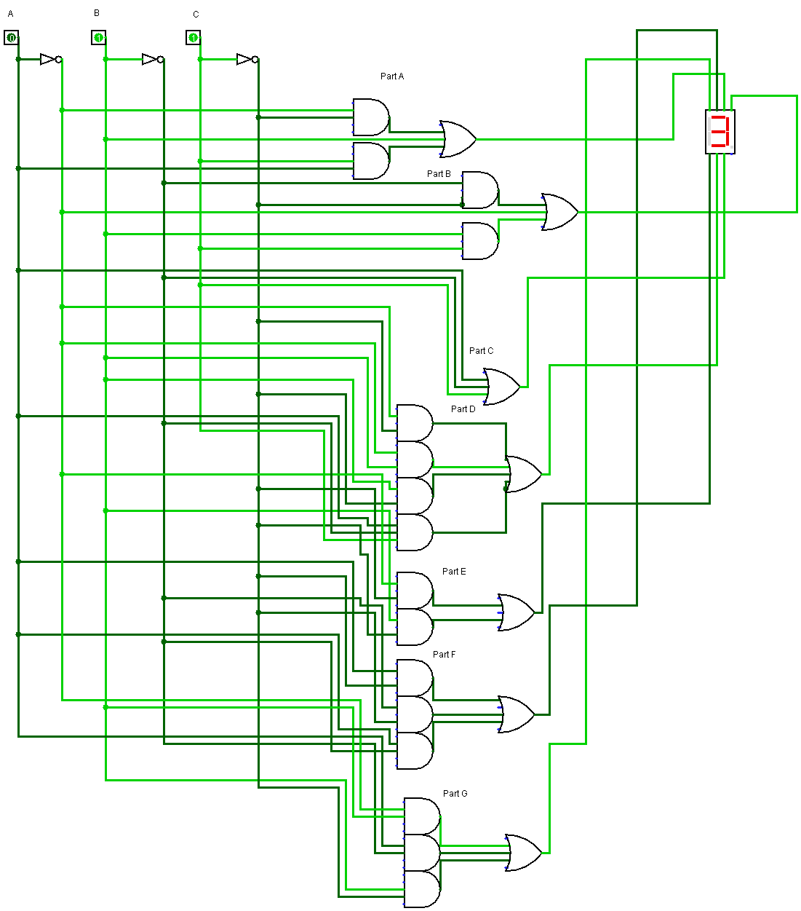
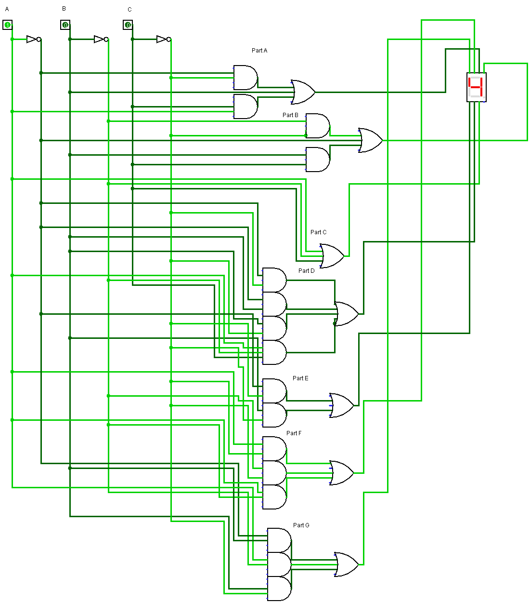
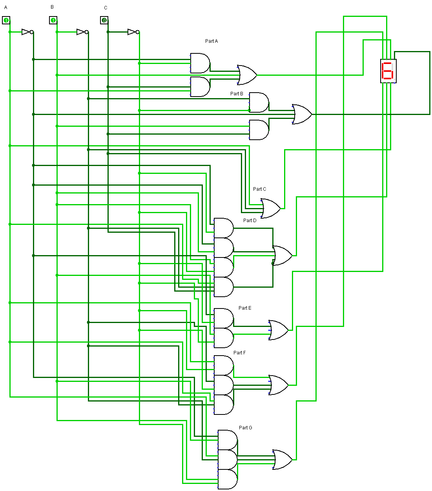
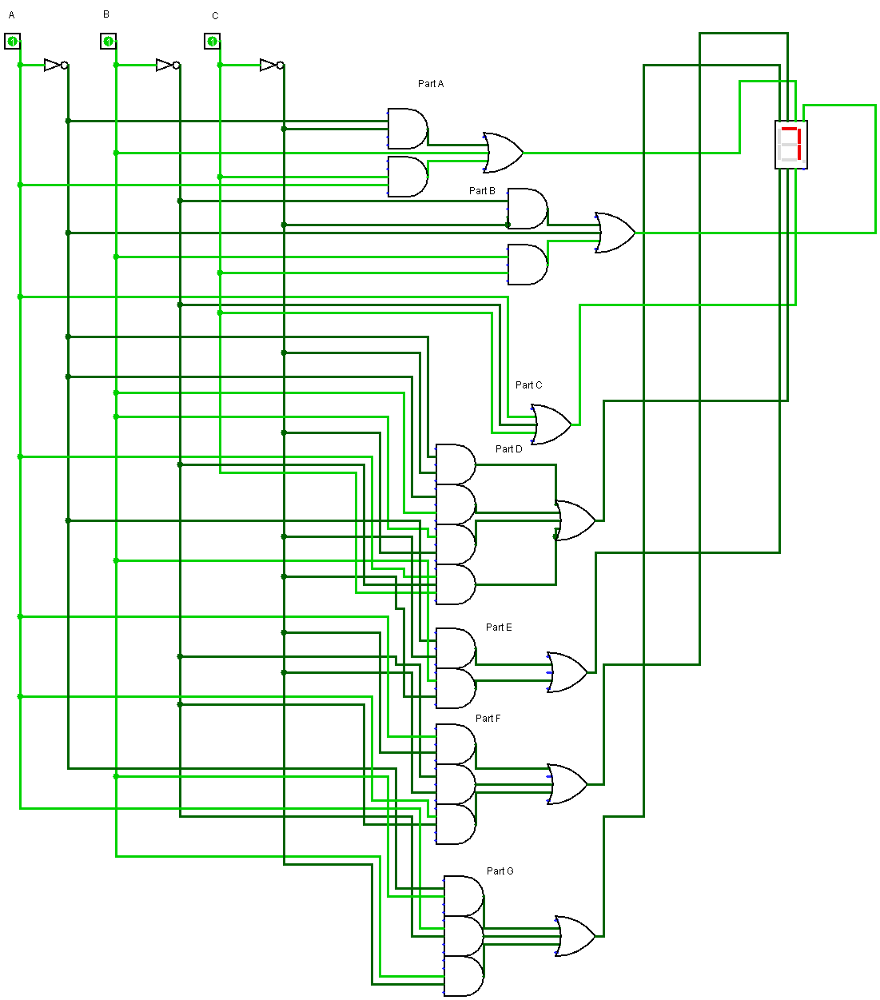

# 3-Bit Binary to 7-Segment Display Decoder

A combinational logic circuit, built in Logisim, that turns a 3-bit binary input into the seven outputs needed to show the matching decimal digit (0–7) on a 7-segment display.

  

---

## Table of Contents

- [Overview](#overview)
- [Process](#process)
  - [1. Truth Table](#1-truth-table)
  - [2. Karnaugh Maps](#2-karnaugh-maps)
  - [3. Logisim Implementation](#3-logisim-implementation)
- [Results](#results)
- [Difficulties](#difficulties)
- [Tools Used](#tools-used)
- [Author](#author)

---

## Overview

To turn a 3-bit binary input into seven outputs, each corresponding to a part of representing said number in decimal, a decoder is required. Decoders are often used in circuitry to cover a wide variety of input combinations. In this specific lab, a decoder translates binary to the corresponding inputs of a 7-segment display.

| | |
|---|---|
| **Inputs** | `A`, `B`, `C` (3-bit binary, `A` is the most significant bit) |
| **Outputs** | Segments `a`–`g` of a 7-segment display |
| **Range** | Decimal digits 0–7 |

---

## Process

### 1. Truth Table

In order to derive these outputs, a truth table can be used. To set up the truth table, set the inputs A, B, and C to each binary combination for numbers 0–7. These will then be compared with the inputs required to create each number on the display. In essence, this truth table will match the required combination of the 3 inputs to the desired 7 outputs needed to produce the desired number.

| Digit | A | B | C | a | b | c | d | e | f | g |
|:-----:|:-:|:-:|:-:|:-:|:-:|:-:|:-:|:-:|:-:|:-:|
| 0 | 0 | 0 | 0 | 1 | 1 | 1 | 1 | 1 | 1 | 0 |
| 1 | 0 | 0 | 1 | 0 | 1 | 1 | 0 | 0 | 0 | 0 |
| 2 | 0 | 1 | 0 | 1 | 1 | 0 | 1 | 1 | 0 | 1 |
| 3 | 0 | 1 | 1 | 1 | 1 | 1 | 1 | 0 | 0 | 1 |
| 4 | 1 | 0 | 0 | 0 | 1 | 1 | 0 | 0 | 1 | 1 |
| 5 | 1 | 0 | 1 | 1 | 0 | 1 | 1 | 0 | 1 | 1 |
| 6 | 1 | 1 | 0 | 1 | 0 | 1 | 1 | 1 | 1 | 1 |
| 7 | 1 | 1 | 1 | 1 | 1 | 1 | 0 | 0 | 0 | 0 |

After creating the truth table, logic sets of minterms were gathered for each of the 7 segments.

  

### 2. Karnaugh Maps

These minterm equations were then simplified using Karnaugh Maps to reduce them to their simplest form.

  

### 3. Logisim Implementation

Using these equations, all that was left was to create the circuit. Using Logisim, each equation was implemented together to produce the intended circuit.

Each segment (Part A through Part G) has its own group of AND gates feeding an OR gate, and each OR gate drives one segment of the display. The inputs `A`, `B`, and `C` are also inverted so both the normal and complemented signals are available to every gate.

---

## Results

Every input combination from `000` to `111` was tested, and the display shows the correct digit each time.

<table align="center">
  <tr>
    <td align="center"> <b>000 → 0</b></td>
    <td align="center"> <b>001 → 1</b></td>
    <td align="center"> <b>010 → 2</b></td>
    <td align="center"> <b>011 → 3</b></td>
  </tr>
  <tr>
    <td align="center"> <b>100 → 4</b></td>
    <td align="center"> <b>101 → 5</b></td>
    <td align="center"> <b>110 → 6</b></td>
    <td align="center"> <b>111 → 7</b></td>
  </tr>
</table>

*Inputs are shown in the order `ABC`.*

---

## Difficulties

The most difficult part of this lab was the creation of the initial equations and the implementation of the simplified equations into Logisim. These difficulties stemmed more from a place of tedium than from a place of confusing logic. Understanding the general logic enabled me to focus on making sure I was righting equations properly and wiring the proper input to each logic gate.

---

## Tools Used

- [Logisim](http://www.cburch.com/logisim/) for building and simulating the circuit
- Truth table and Karnaugh maps for deriving and simplifying the segment equations

---

## Author

**Myles Hendler-Voss**
